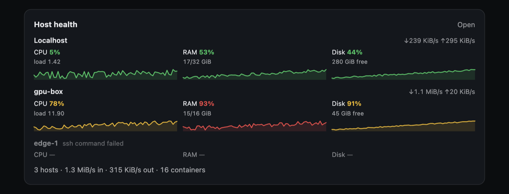
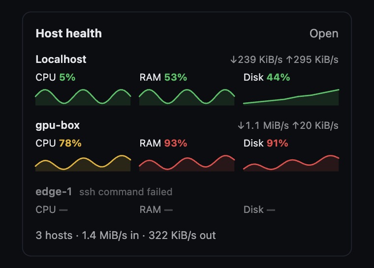

# System Stats (Paperclip plugin)

Real-time CPU, RAM, disk, network and Docker monitoring for the Paperclip host and any configured remote execution hosts. A worker collects metrics from Linux `/proc`, `df`, `ps` and `docker`; the UI renders them as a live dashboard page and a compact dashboard widget.

| Where | What it shows |
|---|---|
| **System** page (`/<company>/system-stats`) | Host tabs, a live indicator, CPU (usage, load, PSI, cores), memory (used/total, swap, buffers), per-mount disk table, per-interface network rates, per-container Docker stats, top processes — plus a **rolling 30-minute chart** for each metric. |
| Dashboard widget | A compact row per host (CPU/RAM/disk percentages, network throughput) with a tiny CPU sparkline, plus a link to the page. |

The page appends new samples every `ui_refresh_seconds` (default 2) and keeps a rolling `history_window_seconds` window (default 1800, i.e. 30 minutes) per host. A **Refresh** button forces a collection immediately.

## Screenshots

The dashboard widget draws one line per headline metric — CPU, RAM and disk — for every host, with ok / warn / crit colouring on both the value and the line. An unreachable host shows dashes instead of a phantom `0%`:



The same rows reflow cleanly in a narrow dashboard slot:



## Data gathered

| Metric | Source |
|---|---|
| CPU usage % | `/proc/stat` — two samples, jiffy delta |
| CPU load 1/5/15 | `/proc/loadavg` |
| PSI pressure | `/proc/pressure/cpu` (`avg10`; omitted when the kernel has no PSI) |
| RAM total/used/available | `/proc/meminfo` (`MemTotal`, `MemAvailable`) |
| Swap | `/proc/meminfo` (`SwapTotal`, `SwapFree`) |
| Disk usage | `df -k --output=...` (falls back to `df -kP`) |
| Network RX/TX | `/proc/net/dev` — two samples → bytes/packets per second |
| Interface state / speed | `/sys/class/net/<if>/{operstate,speed}` |
| Docker containers | `docker stats --no-stream --format json` |
| Docker disk | `docker system df` |
| Top processes | `ps -eo pid,pcpu,pmem,comm --sort=-pcpu` |
| Uptime | `/proc/uptime` |

Collection never throws: a missing tool becomes an empty section, and a missing `/proc` becomes an unavailable host with a reason.

## Install

The plugin must run on the same machine as the Paperclip host, because it reads that host's `/proc`, `df`, `ps` and `docker`. It needs **Node ≥ 24.11** and a Linux host (a macOS/Windows host is reported as unavailable rather than crashing).

### From npm

```sh
npx paperclipai plugin install paperclip-plugin-system-stats
```

### From a local checkout (development)

```sh
git clone https://github.com/NikolaDespotoski/paperclip-system-stats-plugin.git
cd paperclip-system-stats-plugin
npm ci
npm run build
paperclipai plugin install "$(pwd)"
```

### From a git URL

```sh
paperclipai plugin install github:NikolaDespotoski/paperclip-system-stats-plugin
```

### After installing

1. Go to **Settings → Plugins → System Stats** and enable it.
2. Adjust `sample_interval_seconds`, `history_window_seconds`, `ui_refresh_seconds`, `remote_hosts` and `thresholds` (see [Configuration](#configuration)).
3. Open the **System** page in the sidebar, or find the **Host Health** widget on the dashboard.

## Configuration

Configured in **Settings → Plugins → System Stats**. The schema is also in [`src/config.ts`](src/config.ts).

| Key | Default | Meaning |
|---|---|---|
| `sample_interval_seconds` | `5` | How often the worker records one raw sample per host. Minimum 2; `0` disables timer and on-read sampling (the once-a-minute sweep and `Refresh` still collect). |
| `history_window_seconds` | `1800` | Retention window for the rolling series, in seconds (minimum 60). |
| `ui_refresh_seconds` | `2` | How often the open page fetches the newest snapshot and appends new chart points. |
| `include_loopback_interfaces` | `false` | Include `lo` in the network card. |
| `include_docker_bridge` | `false` | Include `docker0` / `br-*` / `veth*` interfaces. |
| `docker_socket_path` | `/var/run/docker.sock` | Docker socket for `docker -H`. |
| `remote_hosts` | `[]` | SSH or webhook hosts (below). |
| `thresholds` | see below | Colour cut-offs. |

### Rolling time series

Each sample is appended to an in-memory ring buffer per host and trimmed to
`history_window_seconds`. Every stored point is the **raw instantaneous
reading** — nothing is averaged, smoothed or rolled up, so a spike is visible at
its true magnitude.

History is persisted to instance-scoped plugin state (`ctx.state`, namespace
`series`, one key per host) and re-hydrated at startup, so a worker restart or
reload does not blank the graphs. The plugin deliberately does **not** use a
plugin-owned database namespace: the `database.namespace.*` capabilities are
company-scoped, while this plugin's sampler is instance-wide with no active
company invocation, so `ctx.db` is not reachable from the sampling loop. If you
lose `ctx.state`, the worst case is a cold-start graph — never a crash.

Sampling is driven from three places, so the graphs stay live even if the worker
process is recycled and loses its timer:

1. a `setInterval` in the worker, every `sample_interval_seconds`;
2. **on read** — whenever the UI asks for stats and the newest sample is older
   than `sample_interval_seconds`, one collection runs first;
3. the `sample-and-prune` manifest job, once a minute, which collects and then
   trims each buffer to the window.

A `sample_interval_seconds` of `0` turns off (1) and (2); the once-a-minute job
and the **Refresh** button still collect.

### Remote hosts

**Strategy A — SSH pull (zero remote setup).** The worker runs the embedded collector over SSH every cycle.

```json
{
  "remote_hosts": [
    { "id": "gpu-box", "label": "GPU Box", "mode": "ssh", "host": "100.89.40.1", "user": "deploy", "ssh_key_path": "~/.ssh/id_ed25519_paperclip" }
  ]
}
```

The target needs `node` (≥ 18) and the usual Linux tools; the collector is piped to `node -e` as base64, so there is nothing to install.

**Strategy B — Webhook push.** The remote host runs the same collector on a timer and POSTs the JSON to Paperclip. Declare a host with `mode: "webhook"` and a `webhook_secret` (a Paperclip `secret_ref`), then install a systemd timer:

```ini
# /etc/systemd/system/paperclip-stats-collector.service
[Service]
Type=oneshot
Environment=HOST_ID=gpu-box
Environment=PAPERCLIP_URL=https://paperclip.example.com
EnvironmentFile=/etc/paperclip-stats-collector/credentials
ExecStart=/usr/local/bin/paperclip-stats-collector.sh

# /etc/systemd/system/paperclip-stats-collector.timer
[Timer]
OnBootSec=15
OnUnitActiveSec=15
```

The script base64-decodes `REMOTE_COLLECT_SCRIPT` (exported from `src/remote-script.ts`) and POSTs it:

```sh
curl -fsS -X POST "$PAPERCLIP_URL/api/plugins/paperclip.system-stats/webhooks/host-stats" \
  -H "content-type: application/json" \
  -H "x-paperclip-secret: $PAPERCLIP_SECRET" \
  -d "{\"host\":\"$HOST_ID\",\"stats\":$(node -e '<collector>')}"
```

The webhook secret is compared in constant time; pushes with a missing or wrong secret are ignored.

### Thresholds

| Metric | Green | Yellow | Red |
|---|---|---|---|
| CPU % | < `cpu_warn` (70) | → `cpu_crit` (90) | ≥ 90 |
| RAM % | < `mem_warn` (70) | → `mem_crit` (90) | ≥ 90 |
| Disk % | < `disk_warn` (70) | → `disk_crit` (90) | ≥ 90 |
| Load / core | < 1.0 | 1.0–2.0 | > 2.0 |
| Docker CPU | < `docker_cpu_warn` (80) | → 95 | ≥ 95 |

## Graceful degradation

- **No Docker** — the Docker card says so; nothing crashes.
- **No remote hosts** — only localhost is shown and the host tabs are hidden.
- **No PSI** — the PSI row shows "not available".
- **No network permissions** — the network card shows an error state.
- **SSH failure** — the remote card shows "unreachable" with the reason.
- **No history yet** — charts show "Collecting samples…" until the first point lands; an unavailable host keeps its last-known series and is never charted as a zero.

## Development

```sh
npm run typecheck   # worker and UI
npm test            # vitest: parsers, collectors, remote and worker wiring
npm run build       # dist/ (worker via tsc, UI bundle via esbuild)
```

The worker is tested through the SDK's in-memory harness (`createTestHarness`), and the collectors through an injected fake `Platform`, so no Linux host or Docker daemon is needed.

## Security

The plugin declares only the capabilities it uses: the two UI slots, plugin state read/write, the schedule job, webhook receive and secret resolution. It does not call the Paperclip API or arbitrary network hosts (SSH targets come from operator config). Remote stats are stored in instance-scoped plugin state; webhook secrets are resolved at call time and never persisted.
